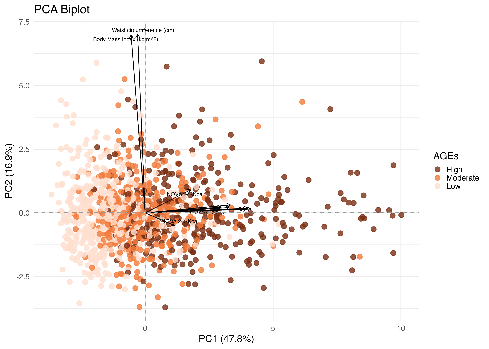

# ENSANUT Analysis

Analysis of the Mexican national health and nutrition survey **ENSANUT 2024**.
The data were curated and analyzed to explore dietary exposures (including
advanced glycation end products, AGEs, and NOVA group 4 ultra-processed foods)
and to identify participant profiles through clustering and dimensionality reduction.

## Figures

**PCA biplot by AGEs intake**



**Correlation between AGEs and NOVA 4 consumption (total population)**


**Hierarchical clustering heatmap (3 clusters)**


## Workflow

The analysis runs as a sequence of R scripts in `R/`:

| Step | Script | Description |
|---|---|---|
| 1 | `1_data_cleaning.R` | Data cleaning and variable selection |
| 2 | `2_stratification.R` | Stratification of the population |
| 3 | `3_heatmap_clustering.R` | Hierarchical clustering and heatmap |
| 3 | `3_barplots_visualization.R` | Bar plots by cluster |
| 4 | `4_pca_visualization.R` | Principal component analysis |
| 4 | `4_umap_visualization.R` | UMAP |
| 4 | `4_tsne_visualization.R` | t-SNE |
| 5 | `5_scatterplots_diabetes.R` | Scatter plots and correlations by diabetes status |

## How to run

The project uses [renv](https://rstudio.github.io/renv/) to keep package versions reproducible.

1. Clone the repository and open the project folder in R (R 4.6).
2. Install the exact package versions:

   ```r
   renv::restore()
