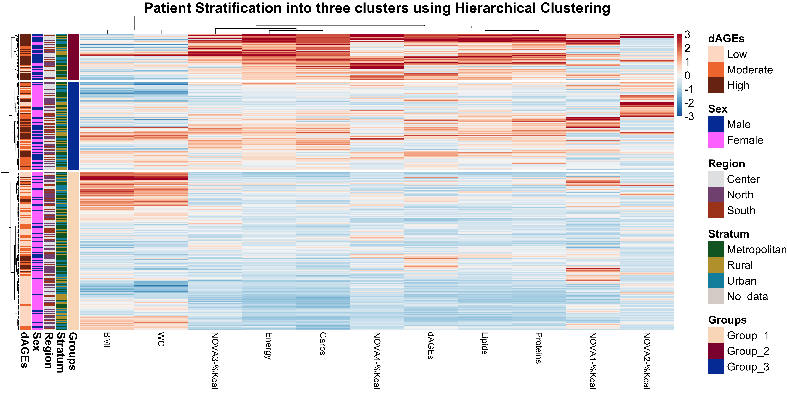

# ENSANUT Cohort Analysis

**Metabolic and dietary phenotyping of a Mexican adult cohort (ENSANUT 2024) using unsupervised clustering and dimensionality reduction in R.**


<p align="center">
  
  
</p>
<p align="center"><sub><b>Left:</b> PCA biplot including dietary advanced glycation end products (AGEs). <b>Right:</b> Heatmap of standardized clinical, metabolic and dietary features across the three clusters.</sub></p>

---

## Overview

This repository contains the R pipeline used to curate and analyze data from the **Encuesta Nacional de Salud y Nutrición (ENSANUT) 2024**, an analytic cohort of **~1,165 participants** with clinical, metabolic and dietary variables.

The analysis:

1. Cleans and standardizes the curated ENSANUT data.
2. Stratifies participants into **three metabolic–dietary phenotypes** (Ward hierarchical clustering, k = 3).
3. Characterizes the clusters by anthropometry, glycaemic markers, ultra-processed food intake (NOVA) and dietary AGEs.
4. Visualizes the structure of the data with PCA, t-SNE and UMAP, and explores diabetes-related relationships.

## Key variables

| Domain | Examples |
|---|---|
| Anthropometric | BMI, waist circumference |
| Metabolic | Glucose, HbA1c, lipid profile |
| Dietary | NOVA food classification (`NOVA_pct`), dietary AGEs |
| Demographic | Age, sex |

> Variable names were standardized from Spanish to English (e.g. `IMC → BMI`, `NOVA_per → NOVA_pct`).

## Repository structure

```
Ensanut_analysis/
├── R/
│   ├── 1_data_cleaning.R             # Cleaning, imputation, normalization
│   ├── 2_stratification.R            # Ward clustering (k = 3)
│   ├── 3_barplots_visualization.R    # Stacked bar charts by cluster
│   ├── 3_heatmap_clustering.R        # Cluster heatmap (pheatmap)
│   ├── 4_pca_visualization.R         # PCA biplots
│   ├── 4_tsne_visualization.R        # t-SNE embedding
│   ├── 4_umap_visualization.R        # UMAP embedding
│   └── 5_scatterplots_diabetes.R     # Glycaemic / diabetes scatterplots
├── pipeline/
│   └── run_all.R                     # Runs the full pipeline in order
├── data/
│   ├── hidden curated data/          # Curated input (not tracked)
│   └── Output/                       # Intermediate and derived tables
├── visualization/
│   ├── ages/                         # Dietary AGEs figures
│   ├── heatmap/
│   ├── pca/
│   └── scatter/
├── renv/                             # renv project library
├── renv.lock                         # Locked package versions
├── renv_install.R                    # Environment setup helper
└── .Rprofile                         # Activates renv on startup
```

## Pipeline

| Step | Script | Output |
|---|---|---|
| 1. Data cleaning | `1_data_cleaning.R` | Clean, imputed, normalized dataset → `data/Output/` |
| 2. Stratification | `2_stratification.R` | Cluster labels (`Group_1`–`Group_3`) |
| 3. Cluster profiling | `3_heatmap_clustering.R`, `3_barplots_visualization.R` | `visualization/heatmap/`, bar charts |
| 4. Dimensionality reduction | `4_pca_visualization.R`, `4_tsne_visualization.R`, `4_umap_visualization.R` | `visualization/pca/`, embeddings |
| 5. Diabetes exploration | `5_scatterplots_diabetes.R` | `visualization/scatter/` |

**Why Ward, k = 3?** Several clustering approaches (k-means, k-medoids, GMM, DBSCAN, HDBSCAN, agglomerative) were compared. Ward linkage with three groups gave the best balance between cluster quality and clinical interpretability.

## Getting started

### 1. Clone and restore the environment

```bash
git clone https://github.com/<user>/Ensanut_analysis.git
cd Ensanut_analysis
```

```r
# In R, from the project root (.Rprofile activates renv automatically)
renv::restore()
# or: source("renv_install.R")
```

### 2. Add the data

Place the curated ENSANUT files in `data/hidden curated data/` (see [Data access](#data-access)).

### 3. Run

```bash
Rscript pipeline/run_all.R
```

Or run the scripts in `R/` one by one in numeric order.

## Data access

ENSANUT microdata are publicly available from the **Instituto Nacional de Salud Pública (INSP)**: <https://ensanut.insp.mx>. The curated data used here are **not** included in this repository.


## Citation

Manuscript in preparation. 


## Author

**Manuel**, PhD in Biomedical Sciences (Maastricht University). Biomedical research and applied AI.

